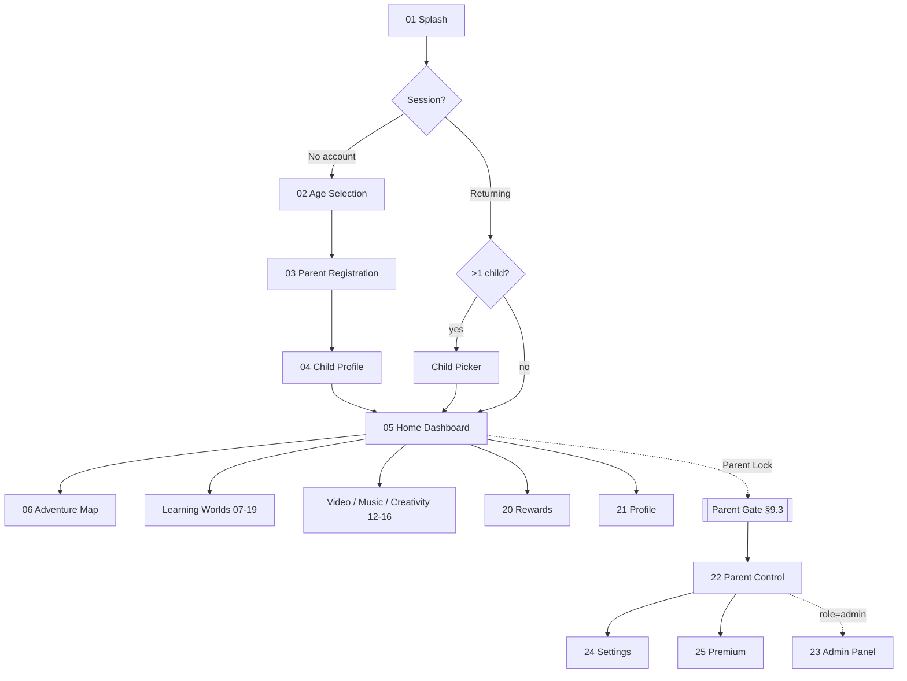
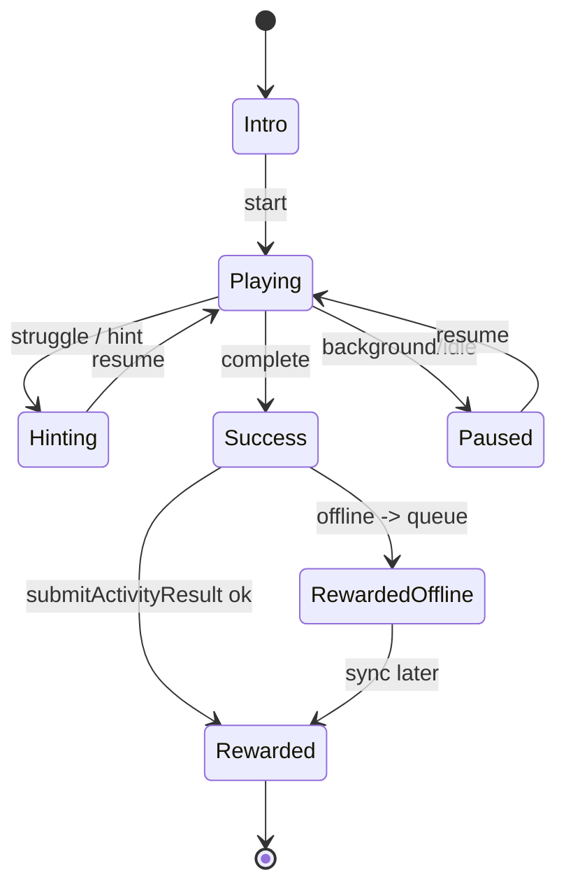
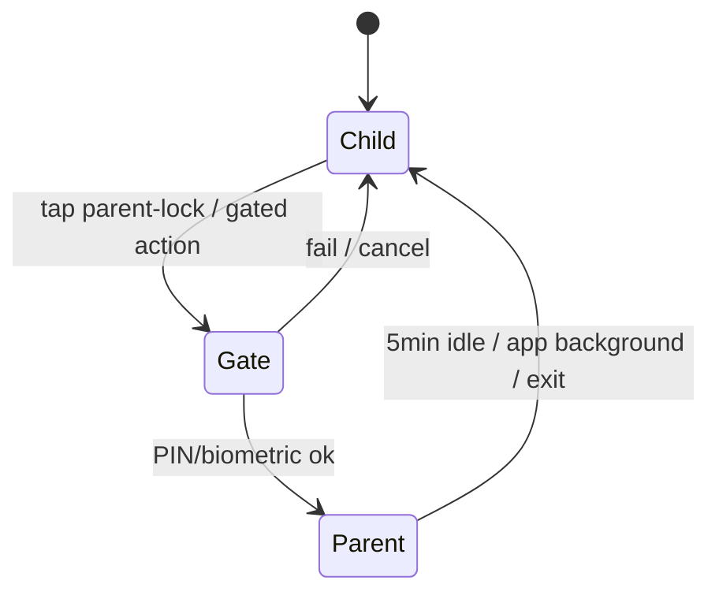
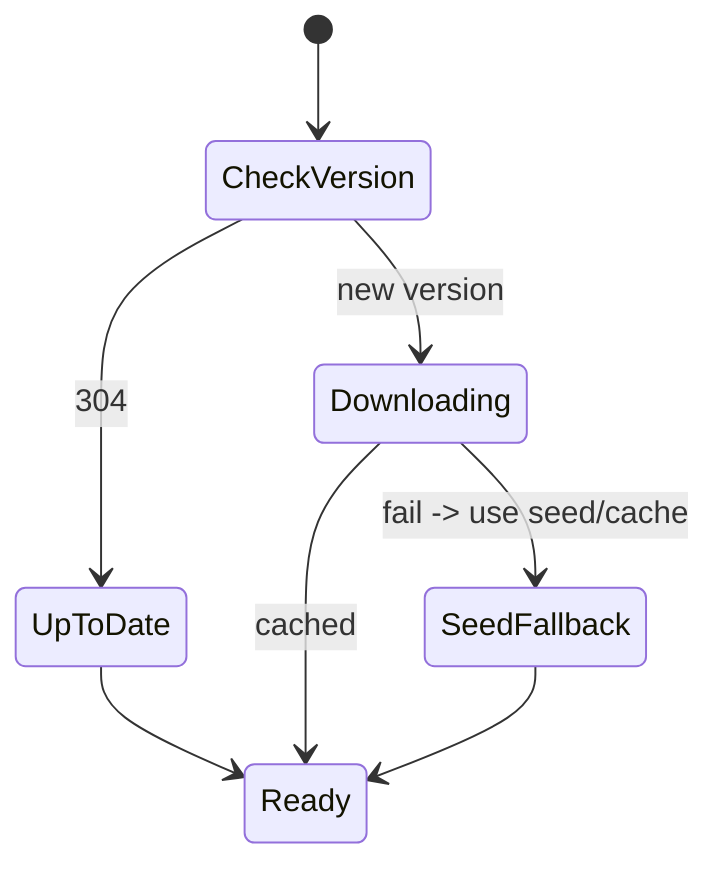

# Smart Beginning — Product, UX & Technical Spec

> Early-learning platform for children aged 0–10, with a parent/admin control plane.
> Platforms: Android + iOS (single **Flutter** codebase, Dart) · Status: Blueprint (pre-implementation)
> This document is the single source of truth for design, engineering and QA. No screen ships without its section here being satisfied.

---

## 0. How to read this document

- **§1–§9** are system-wide: product framing, risks, design system, architecture, navigation, state, data, API, animation and accessibility. Read these before any screen.
- **§10** is the screen catalogue — 25 screens, each with the 13 required facets (Purpose, User Type, Layout, UI Components, Child Interaction Model, Animation, Audio, Empty States, Error States, Accessibility, API Connections, Data Requirements) plus a Flutter widget map.
- **§11–§13** are delivery: micro-interactions, responsive rules, and the build→APK path.
- Every table that says *"Data Requirements"* names concrete fields. Every *"API Connections"* row names a concrete endpoint defined in §8. There are no "TBD"s; where a decision is deliberately deferred it is listed in §1.4 as an open decision with a recommended default already applied.

---

## 1. Product summary

| Item | Value |
|---|---|
| Product | **Smart Beginning** |
| Category | Early-childhood learning (EdTech), ages 0–10 |
| Platforms | Android + iOS, single Flutter codebase |
| Primary users | Children (play), Parents (setup, control, insight), Admin (content & ops) |
| Core value | A single safe, offline-capable, gamified world where children learn letters, numbers, animals, music, science, stories and emotions, while parents retain full control and visibility |
| Monetisation | Freemium → Premium (monthly / yearly / lifetime / family) |
| Business model driver | Parent trust (safety + control) converts free users to paid; adventure-map progression drives retention |

### 1.1 The five viewpoints (required by the brief)

- **Executive** — The moat is *parental trust* and *content depth*, not any single screen. Ship the trust surfaces (COPPA/age-gating, parent lock, no-ads video, offline) to credibility first; they are the conversion lever. Avoid building 9 instrument emulators before a single analytics report the parent can act on.
- **Business user (parent)** — Wants: 2-minute setup, confidence the child is safe, a weekly "here's what your child learned" signal, and one-tap screen-time limits. These are in Parent Control Dashboard (§10.22) and must not be gated behind premium at the safety level.
- **Solution architect** — Offline-first, content-as-data (not hard-coded), a sync engine, and a hard **child-mode vs parent-mode** boundary enforced in the navigation layer, not just the UI. Audio/animation are performance risks — budget them.
- **Engineer** — 25 screens with heavy animation and audio on low-end Android. Flutter + a strict state/layer split, lazy asset loading, and a device-tier fallback for animations. The "9 instruments + 88-key piano + live audio recording" is the single largest technical risk (§1.3).
- **End user (child)** — Large tap targets, no reading required for navigation (icon + voice), immediate feedback (sound + animation) on every tap, and nothing that can trap them in a paywall or an external link.

### 1.2 Scope map — what the 25 screens actually are

Grouped by subsystem so the build can be phased (see §13.4):

- **Onboarding & identity**: 01 Splash, 02 Age Selection, 03 Parent Registration, 04 Child Profile.
- **Shell & navigation**: 05 Home Dashboard, 06 Adventure Map.
- **Learning worlds**: 07 Alphabet Forest, 08 Letter Tracing, 09 Number Kingdom, 10 Animal Kingdom, 11 Bird Paradise, 17 Storyland, 18 Science Planet, 19 Emotion Valley.
- **Media**: 12 Video World, 13 Music Academy, 14 Full Piano, 15 Xylophone, 16 Creativity Studio.
- **Progress & self**: 20 Rewards Center, 21 Profile.
- **Control plane**: 22 Parent Control Dashboard, 23 Admin Panel, 24 Settings, 25 Premium Subscription.

### 1.3 Risk register

| # | Risk | Severity | Mitigation (applied in this spec) |
|---|---|---|---|
| R1 | **Live multi-touch audio** (9 instruments, 88-key piano, recording/playback) is the hardest part and easy to under-estimate on low-end Android | High | Phase it (§13.4). MVP ships Piano + Xylophone only, via a native low-latency audio layer (`flutter_soundpool`/`just_audio` + platform channel to Oboe on Android / AVAudioEngine on iOS). Other instruments are post-MVP. |
| R2 | **COPPA / GDPR-K** — collecting child name, DOB, photos | High | DOB stored as *age band*, not exact date, unless parent opts in. No child PII leaves device without explicit parent consent. Parent email is the only required adult identifier. Age gate before any data entry. See §8.7. |
| R3 | **Animation/audio jank** on low-end devices | High | Device-tier detection (§9.4); Lottie with reduced-motion fallback; particle counts scale by tier; hard 60fps budget with profile-mode gates in CI. |
| R4 | **Content volume** — 26 letters, 1–100 numbers, animals, birds, stories, videos, science modules | High | Content is **data, not code** (§7, §8.4). Admin Panel (§10.23) authors it. App ships with a seed pack; the rest streams/downloads. |
| R5 | **Video hosting & "no ads" + offline downloads** | Medium | Use a CDN + signed URLs (§8.5). Downloads are DRM-light (encrypted local cache keyed to device). Never embed an ad SDK. |
| R6 | **Paywall near children** — accidental purchases | High | All purchase flows are behind the Parent Lock (§9.3). Store billing only (Google Play Billing / StoreKit); no custom card entry. |
| R7 | **9 instruments / 88 keys / DJ pad** scope creep vs. audience | Medium | For ages 0–10, fidelity < delight. Keep instruments simple and forgiving; the "realistic rendering" is visual, not studio-grade DSP. |
| R8 | **Two "map" paradigms** (Home widgets + Adventure Map) can confuse the child | Medium | Home = quick access; Adventure Map = progression. Decision §1.4-D3: Adventure Map is the hero on Home for ages 4+, widgets for ages <4. |

### 1.4 Open decisions (defaults already chosen so build is not blocked)

- **D1 Backend**: Recommend **Firebase** (Auth, Firestore, Storage, Remote Config, Crashlytics, Analytics) for speed + offline sync + Play billing fit. *Default applied throughout §8.* Alternative: Supabase (Postgres) if SQL/portability is valued more than time-to-market.
- **D2 State management**: **Riverpod** (compile-safe, testable, good for offline + async). *Default applied in §5/§6.*
- **D3 Home hero**: Adventure Map for ages ≥4, quick-access widget grid for ages <4. *Applied in §10.05.*
- **D4 Offline scope**: Everything the child touches works offline except first-time video streaming and first content download. Parent reports sync when online.
- **D5 Monetisation gating**: Safety + core alphabet/number play are free forever; depth (full worlds, offline video, creativity export, multiple child profiles >1) is premium.

---

## 2. Design system

A single source of design tokens lives in code at `lib/design/tokens.dart` and is mirrored as Figma variables. Nothing in the app uses a raw hex or magic number — only tokens.

### 2.1 Colour

| Token | Value | Use |
|---|---|---|
| `color.primary` | `#4F8CFF` | Primary actions, active nav, links |
| `color.primaryDark` | `#2E6BE0` | Pressed/primary gradient end |
| `color.secondary` | `#FFB347` | Highlights, rewards, secondary CTAs |
| `color.success` | `#5BD75B` | Correct answers, completion |
| `color.danger` | `#FF6464` | Errors, destructive confirm |
| `color.background` | `#F8FCFF` | App background (light) |
| `color.surface` | `#FFFFFF` | Cards, sheets |
| `color.ink` | `#1E2A3A` | Primary text |
| `color.inkMuted` | `#6B7A90` | Secondary text |
| `color.backgroundDark` | `#0E1726` | App background (dark mode) |
| `color.surfaceDark` | `#17233A` | Cards (dark) |
| World accents | Forest `#5BD75B`, Numbers `#FFB347`, Animals `#FF8A65`, Music `#B388FF`, Science `#4FD1C5`, Story `#F6A6C1`, Emotion `#7FB3FF` | Per-world theming (§6.4) |

Contrast rule: all text/background pairs meet **WCAG 2.2 AA** (≥4.5:1 body, ≥3:1 large). Child-facing labels are large, so the 3:1 path applies but AA 4.5:1 is the target. Dark mode has its own validated pairs, never auto-inverted.

### 2.2 Typography

| Token | Family | Size / weight | Use |
|---|---|---|---|
| `type.display` | **Baloo 2** | 34/700 | Hero greetings, world titles |
| `type.h1` | Baloo 2 | 28/700 | Screen titles |
| `type.h2` | Poppins | 22/600 | Section headers |
| `type.body` | Nunito | 16/400 | Body, parent-facing text |
| `type.bodyStrong` | Nunito | 16/700 | Emphasis |
| `type.label` | Poppins | 14/600 | Buttons, chips |
| `type.caption` | Nunito | 12/400 | Captions, metadata |

Baloo = playful child-facing; Poppins = structural; Nunito = long-form/parent. Dynamic type: scales with OS font setting up to 1.3×. Line height ≥1.3.

### 2.3 Spacing, radius, elevation

- Spacing scale (`space.*`): 4, 8, 12, 16, 20, 24, 32, 40, 48 (dp).
- Radius (`radius.*`): sm 12, md 20, lg 28, pill 999. Child cards use `lg`.
- Elevation: `e1` cards (y2 blur8 8%), `e2` sheets (y8 blur24 12%), `e3` dialogs (y12 blur32 16%).

### 2.4 Buttons & tap targets

- **Minimum tap target 56×56 dp** everywhere (child-safe). Spacing between targets ≥ 12 dp.
- Primary button: pill, `color.primary`→`primaryDark` gradient, `type.label` on white, min-height 56, pressed scale 0.96 + haptic.
- Child "big action" button: 88 dp min, icon + voice label, used in learning worlds.
- Destructive: `color.danger`, always inside a confirm dialog, never one-tap.

### 2.5 Component inventory (design-system level, see §6 for widget tree)

Cards (AgeCard, WorldCard, WidgetTile, StoryCard, VideoCard, RewardCard, PlanCard), Buttons (Primary, Secondary, BigAction, IconButton, SocialLogin), Inputs (TextField, PasswordField, Dropdown, DatePicker, AvatarPicker, MoodWheel), Feedback (Toast, ConfettiOverlay, SuccessGlow, ProgressRing, XPBar, StarRating), Navigation (BottomNav, TopAppBar with Parent-Lock, BackPill, MapNode), System (EmptyState, ErrorState, LoadingShimmer, ParentGateDialog, PermissionPrompt).

### 2.6 Iconography & illustration

- Icons: single-weight rounded set, 2 dp stroke, from one family (e.g. Phosphor-rounded) exported as SVG → `flutter_svg`.
- Illustrations & mascots: vector where possible; animated mascot as **Lottie** (`mascot_idle`, `mascot_wave`, `mascot_cheer`, `mascot_think`). Named asset contract in §7.3.

---

## 3. Design principles (the non-negotiables)

1. **No reading required to navigate.** Every nav item = icon + colour + voice label.
2. **Every tap responds in <100 ms** with sound + motion, even before the real action resolves (optimistic feedback).
3. **No dead ends.** Every screen a child can reach has a visible, large "home/back" affordance.
4. **The child can never reach: purchases, external links, account deletion, another child's data, or the admin panel** — all behind the Parent Gate (§9.3).
5. **Degrade, never crash.** Missing asset → placeholder + retry; offline → cached; low-end device → reduced motion.
6. **Accessibility is default, not a mode** (§9).

---

## 4. Information architecture & navigation

### 4.1 Top-level flow



### 4.2 Navigation layers (architectural boundary, not just UI)

- **Child mode**: Home, Adventure Map, all worlds, media, rewards, profile. Router guard `childModeGuard` forbids routes tagged `parentOnly`.
- **Parent mode**: entered only via Parent Gate; auto-exits after 5 min idle or on app background. Guard `parentModeGuard` requires a valid parent session token held in memory only.
- **Admin**: parent whose account `role == admin`; same gate + server-side role check for every admin API call.

### 4.3 Bottom navigation (child shell)

7 destinations as specified: **Home, Explore, Learn, Videos, Music, Rewards, Profile**. On phones ≤360 dp wide, show 5 + "More" sheet (Music, Rewards collapse into More) to keep 56 dp targets. Active item: filled icon + accent underline + label; others icon + muted.

---

## 5. Technical architecture

### 5.1 Stack

- **Flutter** (stable), Dart 3, null-safe.
- **State**: Riverpod (`flutter_riverpod`, `riverpod_generator`).
- **Routing**: `go_router` with typed routes + the two guards in §4.2.
- **Local**: `drift` (SQLite) for structured offline data (progress, content cache index), `shared_preferences` for flags, encrypted file cache for downloaded media (`flutter_secure_storage` key + AES).
- **Network**: `dio` + `retrofit`, repository layer, offline queue.
- **Media/animation**: `lottie`, `flutter_svg`, `just_audio`, `audio_session`, platform channel to **Oboe** (Android) / **AVAudioEngine** (iOS) for low-latency instruments, `record` for mic capture.
- **Backend**: Firebase (Auth, Firestore, Storage, Remote Config, Crashlytics, Analytics, Cloud Functions), Play Billing / StoreKit via `in_app_purchase`.

### 5.2 Layering

```
presentation (widgets, screens)      <- Flutter, Riverpod consumers
  └─ controllers (Riverpod Notifiers) <- UI state, orchestration
       └─ domain (entities, use-cases, pure Dart, fully unit-tested)
            └─ data (repositories)     <- maps DTO<->entity, offline-first
                 ├─ remote (dio/retrofit, Firebase)
                 └─ local (drift, secure cache)
```

Rule: presentation never touches data directly; domain has zero Flutter imports (keeps it testable and portable). This is the enforceable boundary a reviewer checks.

### 5.3 Offline-first sync

- Writes (progress, rewards, mood logs) go to local drift immediately + enqueue a sync op.
- Sync worker flushes the queue when connectivity returns; conflicts resolve last-write-wins per field with server timestamp, except monotonic counters (XP, coins) which **sum deltas** server-side (never overwrite).
- Content (letters, animals, stories…) is pulled via Remote Config version + Storage; cached by `contentVersion`.

### 5.4 Folder structure

```
lib/
  app/            # bootstrap, router, guards, theme
  design/         # tokens.dart, components/ (design-system widgets)
  features/
    onboarding/ home/ adventure/ alphabet/ tracing/ numbers/
    animals/ birds/ video/ music/ creativity/ story/ science/
    emotion/ rewards/ profile/ parent/ admin/ settings/ premium/
      <feature>/{presentation,controller,domain,data}/
  core/           # network, sync, audio engine, analytics, errors
assets/
  lottie/ svg/ audio/ fonts/ images/ seed-content/
```

---

## 6. Component hierarchy

### 6.1 App shell

```
SmartBeginningApp
└─ ProviderScope (Riverpod)
   └─ MaterialApp.router (theme from design tokens, go_router)
      ├─ ChildShell (BottomNav + IndexedStack of child tabs)
      │   └─ [HomeScreen, ExploreScreen(=AdventureMap entry), LearnScreen,
      │        VideoWorldScreen, MusicAcademyScreen, RewardsScreen, ProfileScreen]
      └─ ParentShell (entered via ParentGate) -> ParentControl / Settings / Premium / Admin
```

### 6.2 Shared design-system widgets (built once, reused)

`SbScaffold` (safe-area, world theming), `SbAppBar` (title, back pill, parent-lock), `SbBottomNav`, `BigActionButton`, `WorldCard`, `WidgetTile`, `ProgressRing`, `XpBar`, `ConfettiOverlay`, `SuccessGlow`, `MascotView` (wraps Lottie states), `VoiceLabel` (text + TTS/clip playback on tap), `EmptyState`, `ErrorState`, `LoadingShimmer`, `ParentGateDialog`, `StarRating`, `RewardChip`.

### 6.3 Reuse map (which screens use which) — abbreviated

- `MascotView`: 01, 05, 06, and all "success" moments.
- `BigActionButton` + `VoiceLabel`: all learning worlds 07–19.
- `ConfettiOverlay` + `SuccessGlow`: every completion (§11).
- `ProgressRing`/`XpBar`: 05, 06, 20, 21, 22.
- `ParentGateDialog`: entry to 22, 23, 24, 25, and video/download approvals.

### 6.4 World theming

`WorldTheme` provides accent + background illustration + mascot palette; injected via Riverpod `worldThemeProvider` keyed by world id so one widget set re-skins per world (maintainability).

---

## 7. Data model (domain entities)

All ids are ULIDs. Timestamps are server UTC. This is the canonical shape; Firestore collections mirror it (§8.4).

### 7.1 Core entities

| Entity | Key fields |
|---|---|
| `ParentAccount` | id, email, name, phone?, country, language, role(`parent`|`admin`), createdAt, subscription(ref), consent{coppaAcceptedAt, dataSharing:bool} |
| `ChildProfile` | id, parentId, name, ageBand(enum), dob?(opt-in only), gender?(enum/null), avatar(AvatarConfig), interests[], learningGoals[], createdAt |
| `AvatarConfig` | skinTone, hair, eyes, dress, accessories[] (all enum ids into asset catalogue) |
| `Progress` | id, childId, worldId, itemId, status(enum: locked/available/inProgress/complete), score, stars(0–3), lastPlayedAt |
| `Wallet` | childId, xp, level, coins, diamonds (monotonic; delta-summed server-side) |
| `RewardItem` | id, type(sticker/trophy/achievement/unlockable/petItem), earnedAt, source |
| `MoodLog` | id, childId, mood(enum), note?, createdAt (child-private; parent sees aggregates only) |
| `ScreenTimeRule` | childId, dailyLimitMin, bedtimeStart, bedtimeEnd, allowedWorlds[] |
| `ContentFilter` | childId, videoRating(maxAgeBand), downloadAllowed:bool, languages[] |
| `Subscription` | parentId, plan(monthly/yearly/lifetime/family), store, status, renewsAt, platformReceiptRef |

### 7.2 Content entities (authored in Admin, shipped as data)

| Entity | Key fields |
|---|---|
| `Letter` | id(A–Z), glyph, phoneme, exampleWord, exampleImage(asset), audio(asset), traceStrokes[] (vector path data), activities[] |
| `NumberItem` | id(1–100), glyph, name, audio, character(asset), personalityBlurb, activities[] |
| `Animal` | id, name, category(farm/jungle/ocean/birds/reptiles/insects), image, sound(audio), facts[], miniGame? |
| `Bird` | id, name, call(audio), habitat, country, facts[], flyAnimation(asset), quiz[] |
| `Story` | id, title, category, pages[{image, text, wordTimings[], narration(audio)}], mode(readToMe/readMyself/interactive) |
| `ScienceModule` | id, topic, simType, assets[], steps[] |
| `Video` | id, title, section, ageBand, durationSec, posterImage, streamUrl(signed), captions?, downloadable:bool |
| `Song`/`Tutorial` | id, instrument, title, noteSequence[], colorGuide[] |

### 7.3 Asset naming contract (so design + eng + admin agree)

- Lottie: `lottie/mascot_{idle|wave|cheer|think}.json`, `lottie/confetti.json`, `lottie/clouds.json`, `lottie/stars_twinkle.json`, `lottie/world_{forest|numbers|...}_intro.json`.
- Audio: `audio/letters/{A}.m4a`, `audio/numbers/{1}.m4a`, `audio/animals/{id}.m4a`, `audio/ui/{tap|success|error|unlock}.m4a`, `audio/welcome.m4a`.
- SVG/images: `svg/worlds/{world}.svg`, `images/avatars/{part}/{id}.png`.

---

## 8. API / backend integration

Firebase-based (D1). Where a REST shape helps, Cloud Functions expose `https` callables. All child-data endpoints require a parent auth token; admin endpoints additionally require `role==admin` verified server-side.

### 8.1 Auth

| Op | Mechanism |
|---|---|
| Register parent | Firebase Auth email/password; `POST createParentProfile` (callable) writes `ParentAccount` |
| Social login | Google, Apple, Microsoft via OAuth providers in Firebase Auth |
| Session | ID token (refresh managed by SDK); parent-mode elevation is a separate in-app PIN/biometric check (§9.3), not a new network session |

### 8.2 Core callables (Cloud Functions)

| Name | In → Out | Used by |
|---|---|---|
| `createParentProfile` | {name,email,phone?,country,language,consent} → ParentAccount | 03 |
| `createChildProfile` | {name,ageBand,dob?,gender?,avatar,interests,goals} → ChildProfile | 04 |
| `getHomeBundle` | {childId} → {child, wallet, suggestedActivity, worldStates[], notifications} | 05 |
| `getAdventureMap` | {childId} → {zones[],nodes[],unlocks[]} | 06 |
| `getWorldContent` | {worldId, contentVersion} → content[] (or 304) | 07–19 |
| `submitActivityResult` | {childId,worldId,itemId,score,stars,durationSec} → {walletDelta, unlocks[], rewards[]} | all activities |
| `getRewards` | {childId} → {wallet, items[], pet, store[]} | 20 |
| `getProfile` | {childId} → {child, stats, recent[], journey[]} | 21 |
| `getParentDashboard` | {parentId} → {children[], analytics, screenTime, filters, subscription} | 22 |
| `updateControls` | {childId, screenTimeRule?, contentFilter?} → ok | 22 |
| `exportData` | {parentId} → signed export url | 22 (GDPR) |
| `getPlans` | {} → plans[] (from Remote Config/store) | 25 |
| `verifyPurchase` | {platform, receipt} → Subscription | 25 |

### 8.3 Admin callables (role==admin)

`adminListUsers`, `adminUpsertContent` (Letter/Animal/Story/Video/…), `adminPublishContentVersion`, `adminModerate`, `adminAnalytics`, `adminSupportTickets`. Every write is audit-logged with actor id.

### 8.4 Firestore collections

`parents/{id}`, `parents/{id}/children/{childId}`, `children/{id}/progress/{itemId}`, `children/{id}/wallet` (single doc, transactionally updated), `children/{id}/rewards/{id}`, `children/{id}/moods/{id}` (rules: readable only by owner parent), `content/{type}/{id}`, `contentVersions/{version}`, `subscriptions/{parentId}`, `auditLogs/{id}`.

### 8.5 Media

- Video: posters in Storage; streams via signed CDN URL from `getVideoUrl` callable (short-TTL). No ad SDK, ever.
- Downloads: `requestDownload` returns a signed URL; file stored AES-encrypted locally, decrypt-on-play; parent approval required if `ContentFilter.downloadAllowed==false`.

### 8.6 Config & telemetry

- Remote Config: content version, feature flags, plan pricing, device-tier thresholds, A/B of Home hero (D3).
- Analytics events are **privacy-safe**: no child name/PII in event params; keyed by anonymised childId hash. Parent can disable analytics in Settings (§10.24) → sets Remote user property + stops non-essential events.

### 8.7 Privacy & compliance (R2)

- Age gate (02) before any PII entry.
- Child DOB optional; default is age band only.
- Child data never shared with third parties; `consent.dataSharing` defaults false.
- `exportData` and account/child deletion available to parent (GDPR/COPPA right to erasure) — deletion cascades child subcollections + purges media cache.

---

## 9. Global accessibility, safety & performance rules

### 9.1 Accessibility (applies to every screen; screen sections only note deltas)

- Every interactive element has a Semantics label; icon-only buttons have a spoken label.
- Min target 56 dp; focus order logical; visible focus ring for switch/keyboard/TalkBack.
- Colour never the sole signal (pair with icon/shape/label).
- Supports TalkBack/VoiceOver; honours OS **reduce-motion** (→ §9.4 low tier) and **bold/large text**.
- Captions available on all video; narration text highlights word-by-word in stories.
- No flashing >3 Hz (seizure safety).

### 9.2 Child-safety invariants

- No outbound links in child mode. No free-text that leaves the device un-moderated. No camera/mic without explicit per-use permission + parent-set allowance. Purchases & account actions behind Parent Gate.

### 9.3 Parent Gate (reusable)

`ParentGateDialog`: a *non-guessable-by-toddler* challenge (e.g. "hold to continue 3 s" + a simple math/word problem for older-child devices) → then PIN or biometric (`local_auth`). Used before: Parent Control, Admin, Settings, Premium, video approval, downloads, any external action. Elevation lasts 5 min, cleared on background.

### 9.4 Performance / device tiers

- Detect tier at boot (RAM, CPU class, OS reduce-motion) → `deviceTierProvider` ∈ {high, mid, low}.
- Animation budget by tier: high = full Lottie + particles; mid = Lottie, fewer particles; low = static/opacity-only, confetti replaced by a single scale-in badge.
- 60 fps target; CI runs a profile-mode frame-budget check on the heaviest screens (Adventure Map, Piano, Science sim).
- Assets lazy-loaded per world; seed pack ≤ 30 MB install; rest on demand.

---

## 10. Screen catalogue

> Each screen lists the 13 required facets. "Accessibility" lists only deltas from §9.1. "API Connections" reference §8. "Flutter widgets" gives the key widget tree.

---

### 10.01 Splash Screen

- **Purpose**: Brand introduction; warm up the engine, resolve session, pre-cache the first bundle.
- **User type**: All (child or parent opening the app).
- **Layout**: Top — animated Smart Beginning logo; Center — mascot; Bottom — loading indicator. Full-bleed sky-gradient background (`color.background`→light blue) with cloud + star layers.
- **UI components**: `MascotView(wave)`, animated logo (Lottie), `LoadingShimmer`/progress dots, version string (tiny, muted).
- **Child interaction model**: None required; passive. Tapping does nothing destructive (optional: tap mascot → extra wave + chime).
- **Animation**: Clouds drift (slow, looped, parallax), stars twinkle (staggered opacity), mascot waves once then idles. Duration 2–4 s, then cross-fade to next route. Low tier: static logo + fade only.
- **Audio**: Soft welcome chime (`audio/welcome.m4a`), respects system mute + in-app volume; never plays if OS silent-at-launch.
- **Empty states**: n/a.
- **Error states**: If session/config fetch fails → still proceed offline to cached Home or Age Selection after max 4 s; never hang on splash. Show a tiny "offline" dot if no network.
- **Accessibility**: Announce "Smart Beginning, loading". Honour reduce-motion. Minimum display time respects "disable animations" by shortening, not removing, the transition.
- **API connections**: silent `getHomeBundle` prefetch if returning child; Remote Config fetch (non-blocking, 4 s cap).
- **Data requirements**: session token (local), last-active childId (local), contentVersion (Remote Config).
- **Flutter widgets**: `SplashScreen` → `Stack[CloudLayer(Lottie), StarLayer, Column[LogoLottie, MascotView], Positioned(bottom: LoadingDots)]`; a `splashControllerProvider` orchestrates min-time + routing decision.

---

### 10.02 Age Selection

- **Purpose**: Choose age band → tailors content, difficulty, and Home layout (D3); also the compliance age gate before any PII.
- **User type**: Parent (ideally), on behalf of child.
- **Layout**: Title + subtitle; scrollable grid of 6 `AgeCard`s (0–12 Months, 1–2, 2–4, 4–6, 6–8, 8–10 Years). 2 columns phone / 3 tablet.
- **UI components**: `AgeCard`(illustration, age label, short description), each 56+ dp, large; `SbAppBar` with back.
- **Child interaction model**: Tap a card → card scales + glows → confirm micro-transition → next. Single select.
- **Animation**: Card press scale 0.96 + `SuccessGlow`; selected card floats forward while others fade; then slide to onboarding.
- **Audio**: Tap sound; optional voice reads the age label.
- **Empty states**: n/a (static set).
- **Error states**: None network-bound; purely local selection.
- **Accessibility**: Each card Semantics = "Age {band}, {description}, button". Grid traversable by TalkBack in order.
- **API connections**: none yet (selection cached locally; persisted with child profile in 04).
- **Data requirements**: writes `selectedAgeBand` (local) consumed by 03/04/05.
- **Flutter widgets**: `AgeSelectionScreen` → `GridView(AgeCard…)`; `ageSelectionProvider` holds choice.

---

### 10.03 Parent Registration

- **Purpose**: Create the adult account that owns children, controls and billing.
- **User type**: Parent.
- **Layout**: Scrollable form; brand header; fields stacked; social-login row; primary "Create Account"; secondary "Already have an account?". Keyboard-aware.
- **UI components**: `TextField`(Parent Name, Email, Phone optional), `Dropdown`(Country, Language), `PasswordField` + `Confirm`, strength meter, `SocialLoginButton`(Google/Microsoft/Apple), consent checkbox (COPPA/Privacy links open in parent-mode webview), Primary button.
- **Child interaction model**: Not a child screen; entered during setup. (No Parent Gate needed here — it *is* the parent creating the account.)
- **Animation**: Inline field validation shake on error; button loading spinner; success → check + transition.
- **Audio**: Minimal (no child voice here).
- **Empty states**: n/a.
- **Error states**: Per-field inline (invalid email, weak password, mismatch), form-level banner for network/`EMAIL_IN_USE`; social-login cancel handled gracefully; offline → "connect to create an account" (registration requires network).
- **Accessibility**: Labels + error text associated to fields; password reveal toggle labelled; dynamic type safe; form submit via keyboard.
- **API connections**: Firebase Auth register / OAuth; `createParentProfile` (§8.2). Consent timestamp stored.
- **Data requirements**: ParentAccount fields (§7.1) + `consent.coppaAcceptedAt`. Password never stored by us (Auth handles it).
- **Flutter widgets**: `ParentRegistrationScreen` → `Form(Column[...])`; `registrationControllerProvider` (validation + submit state); social buttons call `authRepository`.

---

### 10.04 Child Profile Creation

- **Purpose**: Create the child identity + avatar that personalises the whole app.
- **User type**: Parent.
- **Layout**: Two parts — (a) details form; (b) **Avatar Creator** (interactive). Stepper: Details → Avatar → Interests/Goals.
- **UI components**: `TextField`(Child Name), age (prefilled from 02, editable), optional `DatePicker`(DOB, off by default), `Dropdown`(Gender incl. "prefer not to say"), **AvatarPicker** (tabs: Skin tone, Hair, Eyes, Dress, Accessories — each a horizontal swatch/thumbnail strip with live preview), interest chips, learning-goal chips.
- **Child interaction model**: Child may help pick avatar (delightful) but parent confirms. Avatar parts: tap swatch → live preview updates instantly.
- **Animation**: Avatar preview morphs on each change; confetti on "Create Profile"; mascot cheers.
- **Audio**: Tap sounds on avatar parts; mascot cheer on completion.
- **Empty states**: Avatar defaults to a neutral preset so "no selection" still looks complete.
- **Error states**: Name required (inline); if `createChildProfile` fails → save locally + retry via sync; free tier limits to 1 child → prompt upgrade (link to 25 behind Parent Gate) when adding a 2nd.
- **Accessibility**: Avatar swatches have Semantics ("Hair style 3 of 8"); colour choices labelled by name not colour alone; preview change announced.
- **API connections**: `createChildProfile` (§8.2); avatar config validated against asset catalogue.
- **Data requirements**: ChildProfile + AvatarConfig (§7.1). DOB only if parent opts in (R2).
- **Flutter widgets**: `ChildProfileScreen` → `Stepper`/`PageView[DetailsForm, AvatarCreator, InterestsGoals]`; `AvatarCreator` → `Column[AvatarPreview, TabBar, PartStrip]`; `avatarControllerProvider`.

---

### 10.05 Home Dashboard

- **Purpose**: The child's daily launch pad — identity, progress, AI suggestion, and quick access to worlds.
- **User type**: Child (primary); parent-lock entry for adults.
- **Layout**: Header (profile pic, level, XP ring/bar, notification bell, **Parent Lock** icon). Center hero: mascot + greeting + AI-suggested activity card. Quick-access widget grid (Alphabet, Numbers, Animals, Videos, Stories, Music, Science). Bottom nav (§4.3). Per D3: ages ≥4 see the Adventure Map entry as hero; <4 see enlarged widget tiles.
- **UI components**: `SbAppBar`(avatar, `XpBar`, `LevelBadge`, bell, parent-lock), `MascotView`, greeting (`type.display`, time-of-day aware), `SuggestedActivityCard`, `WidgetTile` grid, `SbBottomNav`.
- **Child interaction model**: Tap a tile → enters that world with a world-intro transition. Tap suggestion → deep-link to the exact activity. Tap bell → child-safe notifications (achievements only). Parent-lock → Parent Gate.
- **Animation**: Mascot idle→wave on load; tiles stagger-in; XP bar animates to current value; suggestion card gentle pulse.
- **Audio**: Greeting spoken ("Good morning, {name}!"); tap sounds.
- **Empty states**: New child (no progress) → suggestion = "Start with the letter A"; worlds show "New!" badges instead of progress.
- **Error states**: `getHomeBundle` fails → render from cache; stale banner (tiny); bell empty on error, not broken.
- **Accessibility**: Greeting announced; XP has text equivalent ("Level 3, 40 of 100 XP"); tiles labelled with world name + progress.
- **API connections**: `getHomeBundle` (§8.2); notifications feed; analytics `home_view`.
- **Data requirements**: child, wallet, suggestedActivity, worldStates[], notifications[] (child-safe subset).
- **Flutter widgets**: `HomeScreen` → `CustomScrollView[SliverAppBar(header), SliverToBoxAdapter(hero), SliverGrid(WidgetTile)]`; `homeControllerProvider` (bundle + cache).

---

### 10.06 Adventure Map

- **Purpose**: The primary engagement/progression system — a world map whose zones unlock by learning.
- **User type**: Child (≥4 primarily).
- **Layout**: Large horizontally+vertically pannable illustrated world. Zones: Alphabet Forest, Number Kingdom, Animal Safari, Music City, Science Planet, Story Island, Emotion Valley. A walking character marker shows current position; locked zones are dimmed with a lock + "unlock by…" hint.
- **UI components**: `MapCanvas`(pan/zoom, bounded), `MapNode`(per zone: icon, state, progress), `CharacterMarker`, `BirdGuide`(points to next suggested node), `AchievementPopup`, `TreasureChest` reward nodes.
- **Child interaction model**: Pan to explore; tap an unlocked zone → enter world; tap a locked zone → bird guide explains the unlock condition (voice). Tap treasure → reward animation.
- **Animation**: Walking character idle loop; bird guide flies along a path to the recommended node; treasure opens with sparkle; achievement popups slide + confetti; zone unlock = gate-opening animation.
- **Audio**: Ambient world music (low, loopable, mutable); per-zone stinger on enter; guide voice lines.
- **Empty states**: Fresh start → only Alphabet Forest unlocked; others clearly "coming soon when you learn more".
- **Error states**: `getAdventureMap` fails → cached map; unlock states that can't verify online show last-known + sync later (never falsely lock a completed zone).
- **Accessibility**: This is the hardest screen for a11y — provide a **list alternative** ("Zones" list with the same nodes/states) reachable via a toggle, since a pan-map is hostile to screen readers. Nodes labelled with state + unlock hint. Reduce-motion stops ambient drift.
- **API connections**: `getAdventureMap` (§8.2); unlock recompute after `submitActivityResult`.
- **Data requirements**: zones[], nodes[{id,worldId,state,progress,unlockRule}], character position, pending rewards.
- **Flutter widgets**: `AdventureMapScreen` → `InteractiveViewer(bounded)` over a `Stack[MapBackground, ...MapNode, CharacterMarker, BirdGuide]` + `AchievementPopupOverlay`; `ListAlternative` widget behind an accessibility toggle; `adventureControllerProvider`.

---

### 10.07 Alphabet Forest

- **Purpose**: Explore letters A–Z through play.
- **User type**: Child.
- **Layout**: A forest of 26 giant alphabet "trees"; horizontally scrollable; each tree = one letter with its progress/stickers.
- **UI components**: `LetterTree`(glyph, state, sticker badge), world header, `MascotView`, scroll affordance.
- **Child interaction model**: Tap a letter tree → pronounce letter, play the letter animation and show the related object (e.g. "A" → apple grows on the tree, falls; voice "A for Apple"). Then a menu of activities: Tracing (→08), Matching, Singing, Quiz, each a `BigActionButton`.
- **Animation**: Letter reveal + object grow/fall; sticker unlock pop on first completion; trees sway gently.
- **Audio**: Phoneme + example word ("A… Apple"), per-letter audio asset; activity-complete jingle.
- **Empty states**: All letters start "available"; none locked (exploration-friendly). Stickers empty until earned.
- **Error states**: `getWorldContent(alphabet)` miss → seed pack has A–Z bundled, so this world works fully offline; missing single asset → placeholder glyph + retry.
- **Accessibility**: Each tree labelled "Letter A, not started / completed"; object described ("Apple"); large targets.
- **API connections**: `getWorldContent('alphabet', v)`; `submitActivityResult` per activity; rewards.
- **Data requirements**: Letter[] (§7.2) incl. exampleWord/image/audio; per-letter Progress.
- **Flutter widgets**: `AlphabetForestScreen` → horizontal `ListView(LetterTree)` + activity bottom-sheet; `alphabetControllerProvider`.

---

### 10.08 Letter Tracing

- **Purpose**: Motor-skill practice forming each letter.
- **User type**: Child.
- **Layout**: Top — example letter (animated stroke demo); Center — tracing canvas with guide path + start dot; Bottom — Next, Replay, Hint.
- **UI components**: `TraceCanvas`(guide strokes, user path, particles), stroke-order arrows, `BigActionButton`×3 (Next/Replay/Hint), `ProgressRing`/score, `MascotView`.
- **Child interaction model**: Finger-follow the stroke; path snaps to the guide within tolerance; off-path gives gentle nudge (no harsh fail). Hint animates the next stroke. Finishing all strokes → success celebration + score.
- **Animation**: Animated demo of correct stroke order; sparkle particles follow the fingertip; success = confetti + mascot cheer + star rating. Low tier: particles off, keep the snap + success.
- **Audio**: Voice guidance ("Start at the top"), tap/trace sound, success jingle; optional letter phoneme on completion.
- **Empty states**: n/a (always has a target letter).
- **Error states**: No fail-out; if the child struggles, after N attempts the hint auto-plays. Result save offline-queued.
- **Accessibility**: Provide a non-trace completion path (tap-the-strokes-in-order) for motor-impaired users; voice guidance; reduce-motion keeps demo but removes particles; score has text equivalent.
- **API connections**: `submitActivityResult` (score/stars/duration); unlocks/rewards.
- **Data requirements**: Letter.traceStrokes[] (vector path data), tolerance config, Progress write.
- **Flutter widgets**: `LetterTracingScreen` → `Stack[ExampleHeader, CustomPaint(TraceCanvas) + GestureDetector(pan), ControlsRow]`; `traceControllerProvider` (stroke state machine, scoring).

---

### 10.09 Number Kingdom

- **Purpose**: Numbers 1–100 with counting, tracing and simple math.
- **User type**: Child.
- **Layout**: Castle-themed world; number "characters" 1–100 in a scrollable gallery (paged by tens); each number has animation/voice/personality.
- **UI components**: `NumberCharacterCard`, `BigActionButton`s (Count Objects, Trace Number, Math Challenge), reward chips (coins/stars/achievements), header.
- **Child interaction model**: Tap a number → it comes alive (animation + voice + personality blurb). Choose an activity: Count Objects (tap to count with audio), Trace Number (reuses `TraceCanvas` from 08), Math Challenge (age-scaled: match/add/subtract).
- **Animation**: Number characters bounce/wave; counting objects pop in with each count; math-correct = success glow, wrong = gentle shake + retry.
- **Audio**: Number names, counting cadence, personality voice lines, success/retry sounds.
- **Empty states**: Higher numbers (e.g. >20) locked for youngest bands by difficulty config, shown as "grow to unlock".
- **Error states**: Content offline from seed (1–20 bundled; 21–100 on demand); missing asset → numeric glyph fallback.
- **Accessibility**: Numbers announced; counting has haptic per count option; math answers reachable as large labelled buttons.
- **API connections**: `getWorldContent('numbers', v)`, `submitActivityResult`.
- **Data requirements**: NumberItem[] (§7.2), difficulty band config, Progress/Wallet.
- **Flutter widgets**: `NumberKingdomScreen` → `PageView(tens)` of `GridView(NumberCharacterCard)` → activity sheets; reuses `TraceCanvas`; `numbersControllerProvider`.

---

### 10.10 Animal Kingdom

- **Purpose**: Discover animals by habitat; sounds, facts, a feeding mini-game.
- **User type**: Child.
- **Layout**: Grid of categories (Farm, Jungle, Ocean, Birds→links to 11, Reptiles, Insects). Category → animal grid → animal detail.
- **UI components**: `CategoryTile`, `AnimalCard`, Animal detail (large image, Sound button, fun-facts carousel, "Feed Animal" mini-game button).
- **Child interaction model**: Tap category → animals; tap animal → detail; tap Sound → plays call + animal reacts; facts swipe; feed mini-game = drag food to animal.
- **Animation**: Animal idle movement; reaction on sound; feeding = food flies + happy animation + reward.
- **Audio**: Animal sounds, voice narration of facts, mini-game sfx.
- **Empty states**: Categories with not-yet-downloaded content show a download affordance (parent-gated if `downloadAllowed==false`).
- **Error states**: Sound asset miss → "tap to retry"; detail image miss → silhouette placeholder.
- **Accessibility**: Sound button labelled "Play {animal} sound"; facts readable by TalkBack; mini-game has tap-to-feed alternative to drag.
- **API connections**: `getWorldContent('animals', v)`, media fetch, `submitActivityResult` (mini-game).
- **Data requirements**: Animal[] (§7.2) incl. sound/facts/category; Progress.
- **Flutter widgets**: `AnimalKingdomScreen` → `GridView(CategoryTile)` → `AnimalGrid` → `AnimalDetail(Stack[image, SoundButton, FactsCarousel])`; `animalsControllerProvider`.

---

### 10.11 Bird Paradise

- **Purpose**: A richer bird sub-world: calls, habitat, facts, quiz, collectible album.
- **User type**: Child.
- **Layout**: Interactive forest scene with birds perched/flying; tapping a bird opens its detail; a "Collection Album" tab.
- **UI components**: `BirdScene`(tappable birds), `BirdDetail`(fly animation, call button, habitat, country, facts, mini-quiz), `CollectionAlbum`(grid of discovered/undiscovered birds).
- **Child interaction model**: Tap bird → it flies + calls + detail opens; complete quiz → bird added to album; album shows silhouettes for undiscovered.
- **Animation**: Birds fly along paths; feathers/sparkle on discovery; album card flip on unlock.
- **Audio**: Bird calls, narration, quiz feedback.
- **Empty states**: Album mostly silhouettes at first → motivates collection.
- **Error states**: Call asset miss → retry; offline → discovered birds still viewable from cache.
- **Accessibility**: Birds labelled; call button labelled; quiz options large/labelled; album states ("discovered"/"locked").
- **API connections**: `getWorldContent('birds', v)`, `submitActivityResult` (quiz), rewards (album unlocks).
- **Data requirements**: Bird[] (§7.2), discovery state per child.
- **Flutter widgets**: `BirdParadiseScreen` → `Stack(BirdScene)` + `TabBar[Scene, Album]`; `birdsControllerProvider`.

---

### 10.12 Video World

- **Purpose**: Safe, ad-free, age-filtered video with parental approval and offline downloads.
- **User type**: Child (watch), Parent (approve/limit).
- **Layout**: Netflix-style rails — Continue Watching, Recommended, Alphabet, Learning, Science, Animal, Music, Cartoons. Each a horizontal `VideoCard` rail. Player is a separate full-screen route.
- **UI components**: `VideoRail`, `VideoCard`(poster, title, duration, downloaded badge), `VideoPlayer`(custom controls, quality, captions, no seek-ads), `FavouriteToggle`, `DownloadButton`(parent-gated), age-filter respected.
- **Child interaction model**: Tap card → play; controls are large; favourite via heart; download triggers parent approval if required; watch history feeds Continue Watching.
- **Animation**: Rail scroll, card focus scale, player controls fade; download progress ring.
- **Audio**: Video audio; UI taps muted during playback.
- **Empty states**: No history → hide Continue Watching rail; a section with no age-appropriate content → hidden, not empty-shelled.
- **Error states**: Stream fail → "try again" + fall back to downloaded copy if present; offline → only downloaded videos shown; quality auto-steps down on poor network.
- **Accessibility**: Captions toggle prominent; player controls labelled; respects system captions styling; reduce-motion keeps functional transitions only.
- **API connections**: `getWorldContent('video',v)` for catalogue, `getVideoUrl` (signed), `requestDownload`, watch-history write, favourites, `ContentFilter` enforcement.
- **Data requirements**: Video[] (§7.2), ContentFilter (ageBand/downloadAllowed/languages), watch history, favourites.
- **Flutter widgets**: `VideoWorldScreen` → `ListView(VideoRail→ListView.horizontal(VideoCard))`; `VideoPlayerScreen` → `just_audio`/`video_player` + custom `ControlsOverlay`; `videoControllerProvider`.

---

### 10.13 Music Academy

- **Purpose**: Hub into instruments; free play + practice; recording.
- **User type**: Child.
- **Layout**: Instrument gallery (Piano, Xylophone, Guitar, Violin, Flute, Drums, Tabla, DJ Pad, Keyboard); center shows the chosen instrument's hero; mode toggle Practice/Free Play.
- **UI components**: `InstrumentTile`, hero preview, `ModeToggle`, `RecordButton`, `PlaybackBar`. (Per R1/R7: MVP enables Piano (→14) + Xylophone (→15); others show "coming soon" but are in the gallery.)
- **Child interaction model**: Tap instrument → open its screen; record → captures play; playback replays; practice mode shows guided notes.
- **Animation**: Instrument hero shimmer; record pulse; waveform during capture.
- **Audio**: **Low-latency** instrument audio via native engine (R1); metronome optional.
- **Empty states**: No recordings yet → "Record your first song!".
- **Error states**: Audio engine init fail → message + text; mic denied → explain + link to Settings; recording save offline-local.
- **Accessibility**: Instruments labelled; record/playback labelled; latency-independent visual feedback so deaf/HoH children still get response; reduce-motion safe.
- **API connections**: Mostly local; recordings stored locally, optional cloud backup (premium); `getWorldContent('music')` for tutorials/songs.
- **Data requirements**: Song/Tutorial[] (§7.2), local recordings, instrument unlock state.
- **Flutter widgets**: `MusicAcademyScreen` → `GridView(InstrumentTile)` + `HeroPreview` + `ModeToggle`; `AudioEngine` core service (platform channel); `musicControllerProvider`.

---

### 10.14 Full Piano Screen

- **Purpose**: A playable piano with learning mode, recording, metronome, tutorials.
- **User type**: Child.
- **Layout**: Full-width keyboard (scrollable to span 88 keys; default view shows ~2 octaves, pan for more), top bar with record/metronome/learning toggles, pedal control, tutorial/song selector, performance score panel.
- **UI components**: `PianoKeyboard`(multi-touch), `RecordControls`, `Metronome`, `LearningModeOverlay`(colour-guided falling notes), `SongTutorialPicker`, `ScorePanel`, achievements.
- **Child interaction model**: Multi-touch keys → immediate sound + key-press animation; learning mode highlights the next key by colour; play along → scored; record/playback; pedal sustains.
- **Animation**: Key depress + ripple; colour-guide notes fall to the right key; success/score celebration. Scale key count/visuals by device tier.
- **Audio**: Low-latency per-key samples (native engine); metronome click; sustain handling.
- **Audio behaviour note (R1)**: polyphony cap + sample pooling to avoid GC jank; audio-session configured for mixing/ducking.
- **Empty states**: No tutorial chosen → free play; no recordings yet.
- **Error states**: Engine/sample load fail → degrade to simpler synth tone + warn; too many simultaneous touches → cap gracefully.
- **Accessibility**: Keys labelled (note names optional overlay); learning mode has a non-colour cue (number/label) for colour-blind; visual press feedback independent of audio.
- **API connections**: Local; tutorials/songs via `getWorldContent('music')`; scores via `submitActivityResult`.
- **Data requirements**: note-sample map, Tutorial.noteSequence[], colorGuide[], recordings, scores.
- **Flutter widgets**: `FullPianoScreen` → `Column[TopControls, Expanded(InteractiveViewer(PianoKeyboard=CustomPaint+multi-touch GestureDetector)), LearningOverlay]`; `pianoControllerProvider` + `AudioEngine`.

---

### 10.15 Xylophone Screen

- **Purpose**: Simple, joyful tuned-percussion instrument for the youngest band; song modes.
- **User type**: Child.
- **Layout**: Rainbow bars (colour-labelled), mode selector (Animal Sounds / Alphabet Songs / Number Songs), Record + Share.
- **UI components**: `XylophoneBars`(tappable, colour+label), `ModeSelector`, `RecordButton`, `ShareButton`(parent-gated share).
- **Child interaction model**: Tap bars → note + bounce; mode changes what each bar triggers (note vs animal sound vs sung letter/number); record → share (parent-gated).
- **Animation**: Bar bounce + ripple; sparkle on song completion.
- **Audio**: Tuned samples; mode-swapped sound sets; low-latency.
- **Empty states**: No recordings → prompt.
- **Error states**: Mic/share denied → explain; engine fail → degrade tone.
- **Accessibility**: Bars labelled by note AND colour name (colour-blind safe); large; visual feedback independent of audio.
- **API connections**: Local; alphabet/number/animal sound sets from seed/content; share via system share-sheet behind Parent Gate.
- **Data requirements**: bar→sound maps per mode, recordings.
- **Flutter widgets**: `XylophoneScreen` → `Row(XylophoneBar…)` + `ModeSelector` + controls; `xylophoneControllerProvider` + `AudioEngine`.

---

### 10.16 Creativity Studio

- **Purpose**: Free drawing/creation: brush, crayon, paint, stickers, templates; save/print.
- **User type**: Child.
- **Layout**: Canvas center; tool palette (Brush, Crayon, Paint, Stickers, Templates); color/size pickers; actions: Save to Gallery, Print (parent-gated), plus Animation Maker / Comic Builder / Storybook Creator as advanced modes.
- **UI components**: `DrawCanvas`, `ToolPalette`, `ColorPicker`, `BrushSizePicker`, `StickerTray`, `TemplateGallery`, `Undo/Redo`, `SaveButton`, `PrintButton`(parent-gated).
- **Child interaction model**: Draw with finger; switch tools; drag stickers; pick template; undo/redo; save to local gallery; advanced modes build frames/pages.
- **Animation**: Brush strokes render live; sticker drop bounce; save = thumbnail flies to gallery.
- **Audio**: Soft brush/tap sounds; save jingle.
- **Empty states**: Blank canvas with a faint "start drawing" hint; empty gallery CTA.
- **Error states**: Save fail → keep in-memory + retry; print requires parent gate + a configured printer (system print dialog); large canvas memory guard.
- **Accessibility**: Tools labelled; colour choices named; provide stamp/sticker path for children who can't draw freehand; undo reachable.
- **API connections**: Local-first; optional cloud backup/export (premium) via Storage; print via OS.
- **Data requirements**: canvas model (layers/strokes), sticker/template catalogue, saved artworks (local).
- **Flutter widgets**: `CreativityStudioScreen` → `Stack[DrawCanvas(CustomPaint+Gesture), ToolPalette, StickerTray]`; `creativityControllerProvider` (undo stack).

---

### 10.17 Storyland

- **Purpose**: Interactive storybooks with read-to-me / read-myself / interactive modes.
- **User type**: Child (read), Parent (bedtime).
- **Layout**: Bookshelf by category (Adventure, Moral, Educational, Science, Bedtime, Interactive); book → reader with page turns.
- **UI components**: `Bookshelf`(`StoryCard` by category), `StoryReader`(page image, text, word-highlight, narration controls, bookmark), mode toggle.
- **Child interaction model**: Pick book → reader; "Read to me" narrates with word-by-word highlight; "Read myself" is silent with tap-word-to-hear; interactive stories have choice taps; bookmark to resume.
- **Animation**: Page-turn; characters animate on narrated pages; word highlight sync to narration timings.
- **Audio**: Character voices/narration; per-word audio on tap; page-turn sound.
- **Empty states**: No bookmarks → start fresh; locked premium books show lock + sample.
- **Error states**: Narration asset miss → fall back to on-device TTS; offline → downloaded/seed stories only.
- **Accessibility**: Word highlighting aids reading; adjustable narration speed; TalkBack reads page text; high-contrast text option; reduce-motion keeps page change without flourish.
- **API connections**: `getWorldContent('story', v)`, narration media, bookmarks, `submitActivityResult` (interactive choices).
- **Data requirements**: Story[] (§7.2) incl. pages/wordTimings/narration, bookmarks per child.
- **Flutter widgets**: `StorylandScreen` → `GridView(StoryCard)` → `StoryReader(PageView[StoryPage])`; `storyControllerProvider` (narration sync).

---

### 10.18 Science Planet

- **Purpose**: Explorable science modules with interactive simulations.
- **User type**: Child (older bands primarily).
- **Layout**: A 3D-ish planet/world view with module hotspots: Dinosaurs, Space, Weather, Plants, Human Body, Volcanoes, Experiments. Module → interactive sim / mini-lab.
- **UI components**: `PlanetView`(module hotspots), `ModuleScreen`(simulation surface, controls, info), `MiniLab`(step-based experiment), particle effects.
- **Child interaction model**: Tap hotspot → module; manipulate the sim (e.g. make a volcano erupt, grow a plant, assemble body parts); step through experiments.
- **Animation**: Simulations (particles, physics-lite); eruptions, weather, growth; results celebration.
- **Audio**: Narration, sim sfx.
- **Empty states**: Advanced modules locked for youngest; "coming soon" for not-yet-downloaded.
- **Error states**: Heavy sims gated by device tier (low tier gets a simplified/animated version, not a physics sim); asset miss → info-card fallback.
- **Accessibility**: Each sim has a described outcome + a non-dexterity trigger (button to "erupt" vs. requiring a gesture); reduce-motion simplifies particles; narration throughout.
- **API connections**: `getWorldContent('science', v)`, `submitActivityResult`.
- **Data requirements**: ScienceModule[] (§7.2), sim configs, Progress.
- **Flutter widgets**: `SciencePlanetScreen` → `Stack(PlanetView hotspots)` → `ModuleScreen`(sim via CustomPaint/`flame` for the few that need a game loop); `scienceControllerProvider` + `deviceTierProvider`.

---

### 10.19 Emotion Valley

- **Purpose**: Social-emotional learning: recognise feelings, calm down, build confidence/gratitude.
- **User type**: Child; parent sees aggregates (not raw notes).
- **Layout**: Mood Wheel center; cards for Emotion Cards, Breathing, Meditation, Confidence Builder, Gratitude, Daily Positivity; AI mood insights (parent-facing, aggregate).
- **UI components**: `MoodWheel`(select feeling), `EmotionCard`, `BreathingExercise`(expanding circle), `Meditation`(audio + visuals), `GratitudeActivity`, `PositivityCard`.
- **Child interaction model**: Spin/tap the wheel to log a mood; do a breathing exercise (follow the circle); pick gratitude items; receive a daily positive message. Logs are child-private.
- **Animation**: Mood wheel rotation + selection glow; breathing circle expand/contract (paced); gentle, calming motion throughout.
- **Audio**: Calm music, breathing cues, affirmations (soft voice).
- **Empty states**: No mood logged → friendly prompt; insights need ≥N logs before showing a trend.
- **Error states**: Offline → log locally, sync later; insights unavailable offline → "check back online".
- **Accessibility**: Moods labelled by name + face + colour (not colour alone); breathing has audio + haptic pacing for low-vision; calming by design (reduce-motion respected but motion here is slow and safe).
- **API connections**: MoodLog writes (child-private rules §8.4), aggregate `moodInsights` for parent dashboard.
- **Data requirements**: MoodLog[] (§7.1), affirmation content, breathing/meditation configs.
- **Flutter widgets**: `EmotionValleyScreen` → `Column[MoodWheel, GridView(activity cards)]`; `BreathingExercise`(AnimatedBuilder); `emotionControllerProvider`.

---

### 10.20 Rewards Center

- **Purpose**: The motivation economy — show and spend what the child earned.
- **User type**: Child.
- **Layout**: Header with XP/Level, Coins, Diamonds; grids for Stickers, Achievements, Trophies, Unlockables; a Virtual Pet; a Reward Store (spend coins/diamonds).
- **UI components**: `WalletHeader`, `RewardGrid`(stickers/achievements/trophies), `VirtualPet`(reacts/evolves), `RewardStore`(`StoreItemCard`, buy with in-app coins — never real money here).
- **Child interaction model**: Browse earned items; tap a trophy → its story; feed/customise pet with coins; buy store items with earned currency (no real-money path here).
- **Animation**: New-item shine; pet reactions; purchase = coin-spend animation + unlock.
- **Audio**: Reward chimes, pet sounds, purchase sfx.
- **Empty states**: Nothing earned yet → "Play to earn your first sticker!" with a path to a quick activity.
- **Error states**: Wallet sync conflict → server authoritative (delta-summed, §5.3); store buy fail (insufficient coins) → friendly "earn more" (no real purchase).
- **Accessibility**: Counts have text equivalents; items labelled with how they were earned; store items labelled with cost; no colour-only states.
- **API connections**: `getRewards` (§8.2), store purchase (in-app currency, server-validated), wallet reads.
- **Data requirements**: Wallet, RewardItem[], pet state, store catalogue (§7.1/§7.2).
- **Flutter widgets**: `RewardsScreen` → `CustomScrollView[WalletHeader, SliverGrid(rewards), PetSection, StoreSection]`; `rewardsControllerProvider`.

---

### 10.21 Profile Screen

- **Purpose**: The child's "me" page — progress, favourites, journey.
- **User type**: Child (view), Parent (via dashboard for deeper stats).
- **Layout**: Avatar display header; progress overview; favourite activities; achievements; recently played; learning journey timeline; learning statistics (child-friendly).
- **UI components**: `AvatarDisplay`, `ProgressOverview`(rings/bars per world), `FavouritesRow`, `AchievementsRow`, `RecentlyPlayed`, `JourneyTimeline`, `StatsCards`.
- **Child interaction model**: Tap a recent/favourite → jump back in; tap achievement → detail; mostly celebratory/read.
- **Animation**: Progress rings animate in; timeline reveal; avatar idle.
- **Audio**: Light tap sounds; optional spoken "You've learned 12 letters!".
- **Empty states**: New child → journey shows "Your adventure starts here" with a CTA.
- **Error states**: `getProfile` fail → cached; partial data renders what's available.
- **Accessibility**: All stats have text equivalents; timeline items labelled with date + what was learned.
- **API connections**: `getProfile` (§8.2).
- **Data requirements**: child, per-world Progress, favourites, achievements, recent[], journey[].
- **Flutter widgets**: `ProfileScreen` → `CustomScrollView[AvatarHeader, ProgressOverview, SliverList(sections)]`; `profileControllerProvider`.

---

### 10.22 Parent Control Dashboard

- **Purpose**: The trust + control + insight center — the business's conversion and retention lever.
- **User type**: Parent (behind Parent Gate §9.3).
- **Layout**: Biometric/PIN entry → dashboard with sections: Learning Analytics, Screen Time, Content Filters, Video Permissions, Download Permissions, Language Controls, Notifications, Reports, Subscription, Export Data. Child switcher at top if multiple children.
- **UI components**: `ParentGateDialog`(entry), `ChildSwitcher`, `AnalyticsCards`(time, worlds, skills, mood trend aggregate), `ScreenTimeControl`(daily limit, bedtime), `ContentFilterControl`(video age rating, download toggle), `LanguageControl`, `NotificationSettings`, `ReportCard`(weekly), `SubscriptionCard`(→25), `ExportDataButton`(GDPR).
- **Child interaction model**: N/A — adult only. Child cannot reach this (guard §4.2).
- **Animation**: Functional, calm (charts animate in). No childish motion here — this is a serious parent surface.
- **Audio**: None/minimal.
- **Empty states**: New account → "Reports appear after your child plays"; analytics need data.
- **Error states**: `getParentDashboard` fail → cached + retry; `updateControls` offline → optimistic local + queued sync with a "will apply when online" note (screen-time limits also enforced locally regardless).
- **Accessibility**: Full WCAG AA; charts have data-table equivalents; controls labelled; adult-readable type sizes.
- **API connections**: `getParentDashboard`, `updateControls`, `exportData` (§8.2); analytics read; subscription read.
- **Data requirements**: children[], analytics, ScreenTimeRule, ContentFilter, Subscription, mood aggregates (not raw notes).
- **Flutter widgets**: `ParentControlScreen` → `ParentGate` → `Scaffold(TabBar/sections)`; `parentDashboardControllerProvider`; local screen-time enforcer service.

---

### 10.23 Admin Panel

- **Purpose**: Content & ops console for the team (not end-parents): manage users, content, rewards, subscriptions, analytics, moderation, support.
- **User type**: Admin (parent account with `role==admin`; gate + server role check on every call).
- **Layout**: Left nav / sections: User Management, Child Profiles, Content Management (Videos, Stories, Lessons), Achievements, Rewards, Subscriptions, Analytics Dashboard, Moderation Tools, Support Center.
- **UI components**: data tables with search/filter, content editors (per entity in §7.2), publish controls (content version), moderation queue, support ticket list, analytics charts.
- **Child interaction model**: N/A. Unreachable in child/normal-parent mode.
- **Animation**: Minimal/functional.
- **Audio**: None.
- **Empty states**: Each section has a clear "no items / create first" state.
- **Error states**: Permission denied → clear message (and the UI shouldn't have been reachable); optimistic edits roll back on server reject; publish is transactional (bump `contentVersion` only on success).
- **Accessibility**: Full WCAG AA; tables keyboard-navigable; this is likely also a web surface — recommend building Admin as a **Flutter Web** target of the same codebase or a separate lightweight web console (decision §13.3).
- **API connections**: §8.3 admin callables; all writes audit-logged.
- **Data requirements**: all content entities, users, subscriptions, tickets, audit logs.
- **Flutter widgets**: `AdminShell` → section routes; reusable `AdminDataTable`, `ContentEditor<T>`; `adminControllerProvider`s per section. (Consider desktop/web layout constraints.)

---

### 10.24 Settings

- **Purpose**: App-wide preferences (some behind Parent Gate).
- **User type**: Parent for sensitive items; a child-safe subset (e.g. music volume) may be inline.
- **Layout**: Grouped list: Language, Theme (incl. Dark Mode), Music Volume, Voice Language, Accessibility, Notifications, Privacy, Data Management (Backup, Restore).
- **UI components**: `SettingTile`(switch/dropdown/slider), `ThemeSelector`, `VolumeSlider`, `AccessibilityPanel`(reduce motion, text size, high contrast, captions default), `PrivacyPanel`(analytics toggle, data sharing, export, delete), `BackupRestore`.
- **Child interaction model**: Sensitive settings gated; volume could be child-accessible from a quick panel.
- **Animation**: Theme change animates; otherwise functional.
- **Audio**: Volume slider previews a sound.
- **Empty states**: n/a.
- **Error states**: Backup/restore failures reported clearly; restore confirms before overwrite (destructive → confirm dialog).
- **Accessibility**: This screen *configures* accessibility and must itself be fully accessible; changes apply live.
- **API connections**: Remote Config read; analytics opt-out write; backup/restore via Storage (premium); language sets locale + content language.
- **Data requirements**: preferences (local + synced), locale, accessibility flags, privacy flags.
- **Flutter widgets**: `SettingsScreen` → `ListView(settings groups)`; `settingsControllerProvider`; theme + locale providers app-wide.

---

### 10.25 Premium Subscription

- **Purpose**: Convert to paid; manage plans. Behind Parent Gate; store-billing only (R6).
- **User type**: Parent.
- **Layout**: Plan cards (Monthly, Yearly, Lifetime, Family), feature-comparison table, benefits list, Purchase CTA, Restore Purchase, Family plan management.
- **UI components**: `PlanCard`(price, period, best-value badge), `FeatureComparisonTable`, `BenefitsList`, `PurchaseButton`(store flow), `RestoreButton`, `FamilyPlanPanel`.
- **Child interaction model**: N/A — gated; no child-reachable purchase anywhere in the app.
- **Animation**: Plan select highlight; purchase success celebration (adult-appropriate).
- **Audio**: Minimal.
- **Empty states**: Already subscribed → show current plan + manage/upgrade instead of buy.
- **Error states**: Store errors (cancelled, pending, already-owned, network) each mapped to a clear message; `verifyPurchase` failure → do not unlock; restore finds nothing → explain.
- **Accessibility**: Prices and periods in text (not image); comparison table has a readable structure; CTA labelled with plan + price.
- **API connections**: `getPlans`, `in_app_purchase` (Play/StoreKit), `verifyPurchase` server-side receipt validation (§8.2); entitlement updates Subscription + unlocks premium content flags.
- **Data requirements**: plans (Remote Config/store), Subscription state, entitlement flags.
- **Flutter widgets**: `PremiumScreen` → `ParentGate` → `Column[PlanCards, ComparisonTable, CTA]`; `purchaseControllerProvider` + `billingService`.

---

## 11. Micro-interactions (global)

Applied uniformly via design-system widgets so they're consistent and cheap to maintain.

- **Every button**: press scale 0.96, release spring-back, tap sound (`audio/ui/tap`), optional particle burst on primary actions, success glow on confirm. Haptic light-impact on press (where available, honoured by a user setting).
- **Every activity completion**: `ConfettiOverlay` (tier-scaled), mascot celebration (`mascot_cheer`), spoken encouragement (randomised from a set), reward distribution animation (coins/XP fly to the wallet in the header).
- **Transitions**: world entry uses a themed wipe/zoom (`world_{x}_intro` Lottie); back uses a soft slide. All ≤300 ms, interruptible.
- **Loading**: `LoadingShimmer` skeletons, never a blank screen; optimistic UI where safe.

Implementation note: these live in `lib/design/components/` as `BigActionButton`, `ConfettiOverlay`, `SuccessGlow`, `MascotView`, and an `interactionFeedback()` helper (sound+haptic+scale) so a screen never re-implements them.

---

## 12. State diagrams (representative)

### 12.1 Activity lifecycle (all learning activities)



### 12.2 Parent-mode elevation



### 12.3 Content sync



---

## 13. Responsive layout, Figma mapping & build→APK

### 13.1 Responsive rules

- Breakpoints: `compact` <600 dp (phones), `medium` 600–904 dp (small tablets/landscape), `expanded` ≥905 dp (tablets, Admin/web).
- Grids: WidgetTiles 2-col compact / 3-col medium / 4-col expanded. Video rails show more cards as width grows. Learning canvases (trace, piano, draw) scale to available space with min sizes; piano gains more visible keys on wider screens.
- Orientation: child worlds mostly portrait-first; Video player + Piano support landscape. Lock the youngest-band flows to portrait to reduce confusion.
- Safe areas + notches respected via `SbScaffold`.

### 13.2 Figma deliverable structure (for the design team)

- **Pages**: 00 Cover, 01 Design System (tokens, type, components), 02 Onboarding, 03 Shell+Map, 04 Learning Worlds, 05 Media, 06 Progress/Self, 07 Control Plane, 08 Prototype flows.
- **Variables**: colour/space/radius/type tokens matching §2 one-to-one (same names), with light + dark modes.
- **Components**: every entry in §2.5/§6.2 as a Figma component with variants (state, size, world theme).
- **Prototype**: wire the navigation in §4.1 + Parent Gate + an activity completion flow.
- Because tokens share names with `lib/design/tokens.dart`, design↔code stays in sync (maintainability).

### 13.3 Admin surface decision (D-admin)

Recommend building **Admin (23)** as a **Flutter Web** target of the same repo (shared domain/data layers, web-appropriate layout) rather than a separate stack — keeps content models and auth in one place. If the ops team needs richer tables/exports, a thin separate web console talking to the same Cloud Functions is the fallback.

### 13.4 Build phasing (so something ships)

- **Phase 0 — Foundations**: project scaffold, design system, tokens, router+guards, Firebase wiring, auth, child profile, Home shell, offline/drift, analytics/crashlytics, CI. 
- **Phase 1 — MVP learning loop**: Splash, Age, Registration, Child Profile, Home, Alphabet Forest + Letter Tracing, Number Kingdom (1–20), Rewards, Profile, Parent Control (analytics + screen time + gate), Settings, Premium. Seed content offline. *This is the first shippable, demoable APK.*
- **Phase 2 — Worlds & media**: Adventure Map, Animal Kingdom, Bird Paradise, Storyland, Video World (streaming + downloads), Music Academy + Piano + Xylophone.
- **Phase 3 — Depth**: Science Planet, Emotion Valley, Creativity Studio, remaining instruments, Admin Panel, full content pipeline, family plans.

### 13.5 The path to a signed APK (honest and concrete)

A production APK requires all of the following, none of which exist yet and several of which are not code:

1. **A Flutter project** implementing at least Phase-1 screens (this spec is its blueprint).
2. **Assets** — the single biggest non-code dependency: mascot Lottie files, world illustrations, per-letter/number/animal images + audio, fonts (Baloo 2/Poppins/Nunito), UI sounds. These must be produced/licensed (Figma + illustration + audio work) to the §7.3 contract.
3. **A backend** — Firebase project (Auth, Firestore + security rules, Storage, Functions, Remote Config), or the chosen alternative, provisioned with credentials.
4. **Android build config** — `applicationId`, versioning, `minSdk` (recommend 23+), Play Billing, Crashlytics, and a **signing keystore** (`key.jks` + `key.properties`, kept out of git).
5. **A build environment** — Flutter SDK + Android SDK/NDK. This container has neither `flutter` nor the toolchain, so I cannot compile or sign here.

Build commands, once the project + keystore exist:

```bash
flutter pub get
flutter analyze && flutter test        # gates must pass
flutter build apk --release            # or: flutter build appbundle --release (Play Store)
# output: build/app/outputs/flutter-apk/app-release.apk
```

Recommended for distribution: **App Bundle (.aab)** to Play, and `--split-per-abi` APKs for direct installs. A debug/demo APK (`flutter build apk --debug`) can be produced as soon as Phase-0/1 code exists, even before all assets are final (using placeholder-but-functional assets, clearly marked as such).

**What I recommend as the immediate next step**: approve this blueprint, then I scaffold the Phase-0 Flutter project (design system + tokens + router + guards + Firebase wiring + the shell) in `app-smart-beginning/`, which is verifiable and gives you a real `flutter build apk --debug` target. Asset production and Firebase provisioning run in parallel. That gets you a running, installable debug APK on the shortest honest timeline; the signed release APK follows once assets + backend + keystore are in place.

---

## 14. Traceability — brief → this spec

Every element of the pasted brief is covered: all 25 screens (§10.01–§10.25) with the 13 required facets each; micro-interactions (§11); design system — exact colours, typography, button rules, 56 dp targets, child-safe zones (§2); and the final requirement's artefacts — Figma-ready specs (§13.2), component hierarchy (§6), design system (§2), navigation flows (§4), state diagrams (§12), interaction maps (§11), responsive layouts (§13.1), Flutter widget mapping (per screen + §5/§6), API integration points (§8 + per screen), animation specifications (per screen + §11 + §9.4). The "final APK" is addressed honestly in §13.5 with the concrete path to it.
