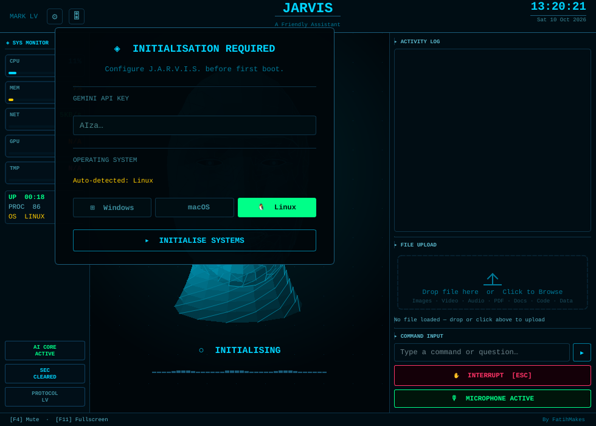

# JARVIS (MARK LV) — One-Click PC Setup

Installers that take a bare PC to a working **[FatihMakes/Mark-LV](https://github.com/FatihMakes/Mark-LV)** JARVIS voice assistant, with a desktop shortcut and verified dependencies. Re-run the same installer at any time to update.



*The screenshot is a real first launch produced by `install-jarvis.sh` on a clean Ubuntu 24.04 machine. Paste your Gemini key into the box and press **INITIALISE SYSTEMS**.*

---

## Before you start (2 minutes)

| Item | Where |
|---|---|
| Free Gemini API key | <https://aistudio.google.com/app/apikey>, then **Create API key** (starts with `AIza…`) |
| Microphone + speakers/headset | Required for voice. A headset avoids JARVIS hearing itself. |
| Disk space | ~3 GB (Python packages ≈ 1.2 GB, browsers ≈ 300 MB) |
| Internet | Downloads come from GitHub, PyPI, Microsoft (winget) and Playwright's CDN |

---

## Windows 10 / 11 (recommended path)

Open **PowerShell** (Start, type `PowerShell`, press Enter; admin is **not** needed) and paste:

```powershell
$u='https://raw.githubusercontent.com/DarkRider999/Kinni/main/jarvis-setup/install-jarvis.ps1'
irm $u -OutFile "$env:TEMP\install-jarvis.ps1"
powershell -ExecutionPolicy Bypass -File "$env:TEMP\install-jarvis.ps1" -Launch
```

Or download `install-jarvis.ps1`, right-click it, choose **Run with PowerShell**.

**What it does, in order:**

1. Checks for 64-bit Windows and ≥ 3 GB free disk.
2. Finds Python 3.11–3.13 (prefers 3.12) using the `py` launcher, which avoids the Microsoft Store `python` alias. If none is found, it installs Python 3.12 per-user via `winget`.
3. Finds Git, or installs it via `winget`.
4. Clones Mark-LV to `%USERPROFILE%\Mark-LV`. If a clone already exists, it does `git pull --ff-only`.
5. Builds an isolated `.venv`, so your system Python and other projects are untouched.
6. Installs `requirements.txt` (Windows-only extras included automatically), updates `yt-dlp`, and downloads the Playwright Chromium + Firefox browsers.
7. Repairs `pywin32` COM registration if needed. If a core module fails with *DLL load failed*, it installs the Visual C++ 2015-2022 runtime and retries.
8. Verifies 18 critical imports, byte-compiles the whole project, and reports your default microphone.
9. Creates `Start-Jarvis.bat` and a **JARVIS** desktop shortcut with the JARVIS icon. The shortcut follows OneDrive Desktop redirection.

A full transcript is written to `%TEMP%\jarvis-install-<timestamp>.log`.

**Options**

| Flag | Effect |
|---|---|
| `-InstallDir D:\Apps\Mark-LV` | Install somewhere else |
| `-SkipBrowsers` | Skip the ~300 MB browser download (only browser automation needs it) |
| `-NoShortcut` | No desktop shortcut |
| `-Launch` | Start JARVIS when finished |

---

## macOS / Linux

```bash
curl -fsSLO https://raw.githubusercontent.com/DarkRider999/Kinni/main/jarvis-setup/install-jarvis.sh
bash install-jarvis.sh --launch
```

Supports apt (Ubuntu/Debian/Mint), dnf (Fedora/RHEL), pacman (Arch/Manjaro) and zypper (openSUSE). If no usable Python 3.11–3.13 is present, it provisions Python 3.12 with `uv`, without sudo or PPAs. Flags: `--dir PATH`, `--skip-browsers`, `--no-shortcut`, `--launch`.

### Linux issues this installer fixes (found while testing)

Each of these breaks a plain `python setup.py` on Linux. All three were reproduced and fixed on Ubuntu 24.04:

| Symptom | Root cause | Fix applied |
|---|---|---|
| `OSError: PortAudio library not found` | `sounddevice` wheels bundle PortAudio on Windows/macOS only | Installs `libportaudio2` / `portaudio` |
| `Could not load the Qt platform plugin "xcb"` | `opencv-python` ships its own Qt plugins and repoints `QT_QPA_PLATFORM_PLUGIN_PATH` on `import cv2`. Separately, minimal installs lack `libxcb-icccm4` / `libxcb-keysyms1` | Swaps in `opencv-python-headless` (Mark-LV never uses OpenCV windows) and installs the full Qt6 xcb library set |
| JARVIS exits silently while loading skills | `pyautogui` → `mouseinfo` calls `sys.exit()` on import when `tkinter` is missing | Installs `python3-tk`, and only accepts a Python that ships `tkinter` |

---

## First launch

1. Double-click **JARVIS** on the desktop, or run `Start-Jarvis.bat` / `start-jarvis.sh`.
2. Paste your Gemini key and press **INITIALISE SYSTEMS**. It is saved to `config/api_keys.json`.
3. Talk. Hold **Ctrl+Space** for push-to-talk, **F4** mutes, **F11** toggles fullscreen.
4. Optional: open ⚙ → **WAKE WORD** to download the local "Hey Jarvis" detector.
5. Optional: open ⚙ → **AUDIO DEVICES** to pick your microphone by name. Windows sometimes defaults to a webcam mic.

## Updating

Run the installer again. It pulls the latest Mark-LV, refreshes packages, and re-verifies. Your API key (`config/api_keys.json`) and memories (`memory/long_term.json`) are git-ignored upstream and are never touched.

## Uninstalling

Delete the install folder and the desktop shortcut. Python and Git stay installed for other uses; remove them from *Settings → Apps* if you want to.

## Troubleshooting

| Problem | Fix |
|---|---|
| `running scripts is disabled on this system` | Use the `powershell -ExecutionPolicy Bypass -File …` form shown above. It applies to this one run only. |
| `winget` not recognised | Install **App Installer** from the Microsoft Store, then re-run |
| JARVIS doesn't hear you | Windows: *Settings → Privacy & security → Microphone →* allow desktop apps. Then pick the mic in ⚙ → AUDIO DEVICES. |
| JARVIS answers itself | Use a headset, or enable push-to-talk in 🎛 CONTROLS |
| `429` / quota errors in the activity log | Free-tier Gemini quota. Mark-LV's model ladder cools down and retries other models automatically, so wait a few minutes. |
| Browser automation says browsers are missing | `"%USERPROFILE%\Mark-LV\.venv\Scripts\python.exe" -m playwright install chromium firefox` |
| YouTube on the HUD stops working | Re-run the installer (it updates `yt-dlp`) |
| `FutureWarning: The pynvml package is deprecated` | Harmless console notice from an upstream dependency |
| Anything else | Read the log path printed at the end of the installer. Every step and error is recorded there. |

## Security notes

- `config/api_keys.json` stores your Gemini key in **plaintext**. Treat it like a password file and never commit it.
- If the key ever leaks, revoke it at <https://aistudio.google.com/app/apikey> and create a new one.
- Mark-LV can control your mouse, keyboard, files and apps by voice. Shutdown, restart and Wi-Fi changes require you to click **CONFIRM** in the HUD.
- Mark-LV is licensed **CC BY-NC 4.0**: personal, non-commercial use only.

---

*Validated against Mark-LV commit `c3e795a` on Python 3.12. Installer runs are idempotent: two consecutive runs on the same machine both completed with exit code 0.*
